# TP N°3 — Développement d'Applications Réparties (LSI3)

## Activité 1 : Serveur multi-thread

Reprise du client/serveur de calcul de l'activité 2-1, transformé en serveur multi-thread.

### 1. Implémentation

- **a) Serveur multi-thread** : `ServerMT3_1` accepte les clients en boucle et lance un thread
  `ClientProcess3_1` pour chacun.
- **b) Infos du client** : le serveur affiche l'adresse (`getRemoteSocketAddress()`) et le numéro
  d'ordre de chaque client.
- **c) Numéro d'ordre** : le thread envoie au client `Bienvenue, vous êtes le client n°X`, puis
  traite ses opérations jusqu'à `quit`.

```java
while (true) {
    Socket socket = serverSocket.accept();
    numero++;
    System.out.println("Client n°" + numero + " connecté, adresse : " + socket.getRemoteSocketAddress());
    new ClientProcess3_1(socket, numero).start();
}
```

---

### 2. Tests locaux

### Clients Java (`IP_SERVEUR = "localhost"`)

### Client n°1

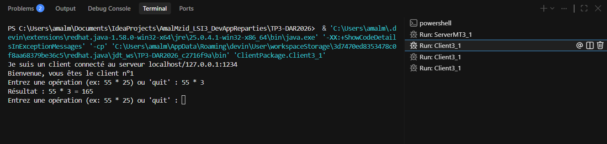

### Client n°2

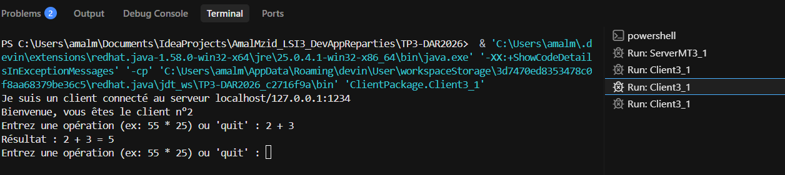

### Client n°3

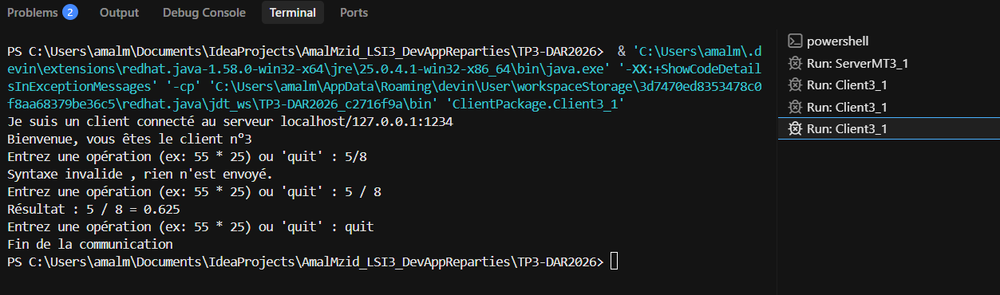

Chaque client reçoit son numéro (n°1, n°2, n°3).

### Console du serveur avec les 3 clients Java

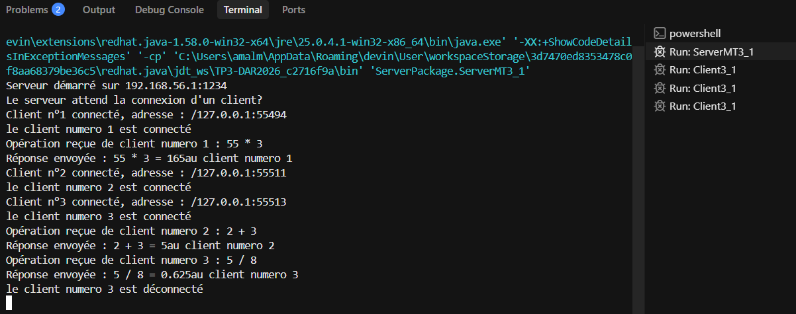

Le serveur gère les 3 clients en parallèle et affiche l'adresse et le numéro de chacun.

### Client Telnet (`telnet localhost 1234`)

### Client Telnet

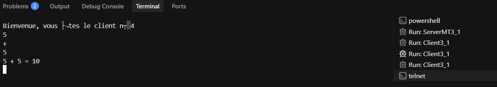

### Console du serveur avec le client Telnet

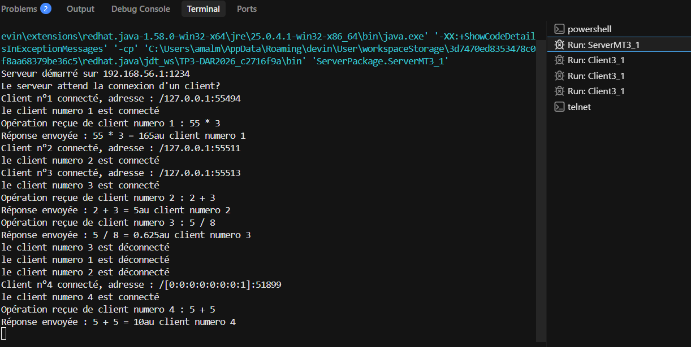

Le client Telnet est le n°4. Il envoie `5`, `+` et `5` sur trois lignes et reçoit `5 + 5 = 10`.


---

### 3. Tests en réseau local

Serveur sur une VM Ubuntu (`192.168.0.122`), clients sur Windows (`192.168.0.19`).
Le client précise l'adresse du serveur avec `InetAddress` et `InetSocketAddress` :

```java
InetAddress adresseServeur = InetAddress.getByName("192.168.0.122");
socket.connect(new InetSocketAddress(adresseServeur, PORT));
```

### Adresse IP de la machine serveur

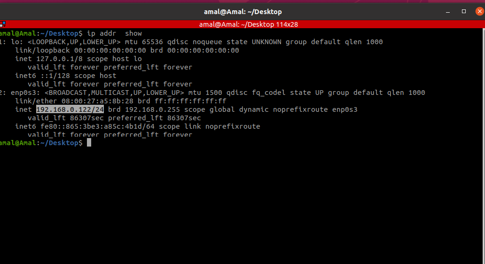

### Copie du code vers la VM avec `scp`

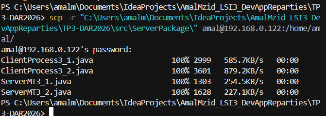

### Compilation du serveur sur la VM


### Lancement du serveur sur la VM

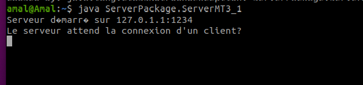

On récupère l'IP de la VM (`ip addr show`), on y copie le code avec `scp`, puis on compile et
on lance le serveur.

### Clients n°1 et n°2 depuis Windows

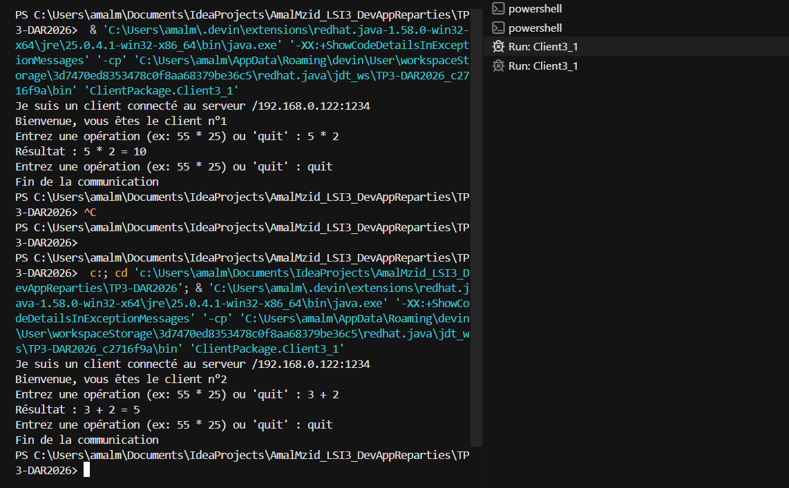

### Client n°3 depuis Windows

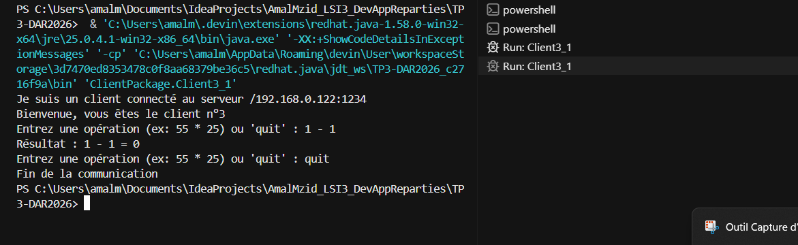

### Console du serveur sur la VM

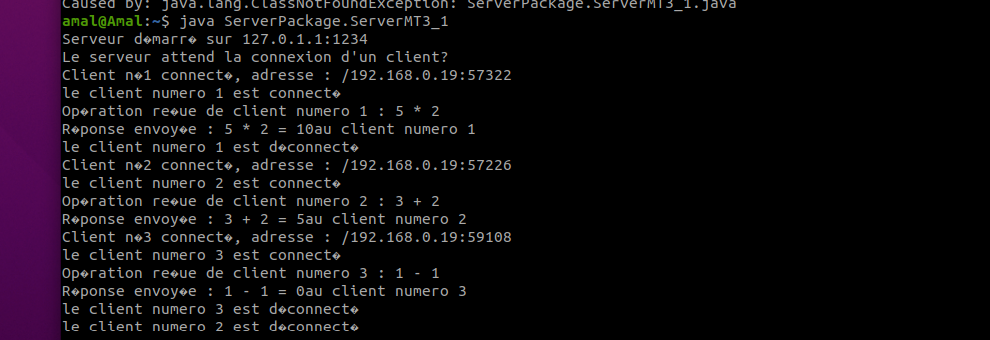

Les 3 clients Windows se connectent au serveur distant. Le serveur affiche leur adresse
`192.168.0.19` et leur numéro d'ordre.

---

## Activité 2 : Service de calculatrice multi-thread (communication par objets)

### Étape 1 : Serveur multi-thread pour la calculatrice

- **1. Serveur** : `ClientProcess3_2` échange des objets avec le client (`ObjectOutputStream` créé
  avant `ObjectInputStream`). Il reçoit un objet `Operation`, calcule le résultat et le renvoie.
- **2. Client** : `Client3_2` lit les deux nombres et l'opérateur, envoie un objet `Operation` avec
  `writeObject()` et affiche le résultat reçu avec `readObject()`.
- La classe `Operation` (`CommonPackage`) implémente `Serializable` et est partagée par le client
  et le serveur.

```java
Operation op = (Operation) ois.readObject();
String reponse = calculer(op.getOperande1(), op.getOperateur(), op.getOperande2());
oos.writeObject(reponse);
```

### Étape 3 : Gestion d'un accès concurrent

Le compteur global `compteurOperations` est partagé par tous les threads `ClientProcess3_2`.
Il est incrémenté dans une méthode `synchronized`, donc un seul thread à la fois peut le modifier.

```java
private static int compteurOperations = 0;

public static synchronized int incrementerCompteur() {
    return ++compteurOperations;
}
```

À chaque opération calculée, le thread appelle `ServerMT3_2.incrementerCompteur()` et affiche
la nouvelle valeur dans la console du serveur.

---

### Tests locaux

### Client n°1

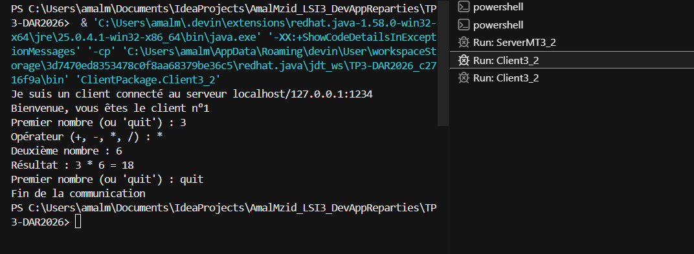

### Client n°2

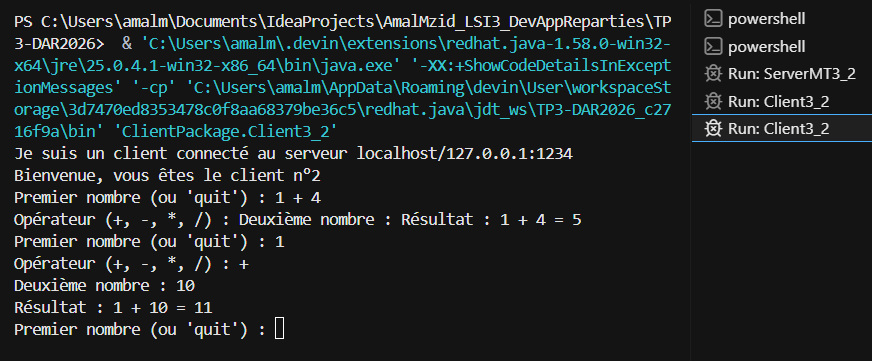

### Console du serveur avec le compteur global

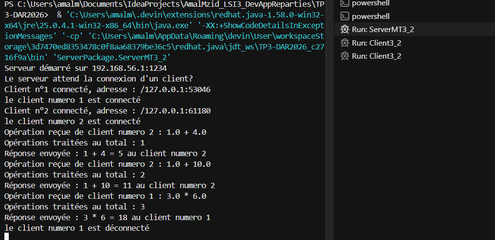

Les 2 clients sont servis en parallèle. Le compteur passe de 1 à 3 quelle que soit l'origine de
l'opération (client n°2 puis client n°1), il reste donc cohérent.

---

### Tests en réseau local

### Copie du code vers la VM avec `scp`

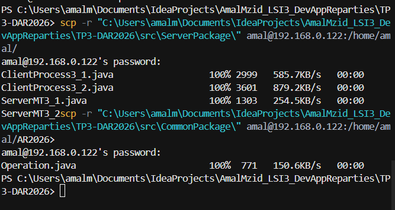

Les dossiers `ServerPackage` et `CommonPackage` (classe `Operation`) sont copiés sur la VM.

### Compilation du serveur sur la VM


### Lancement du serveur sur la VM

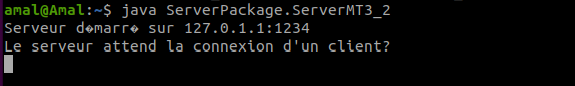

### Client n°1 depuis Windows

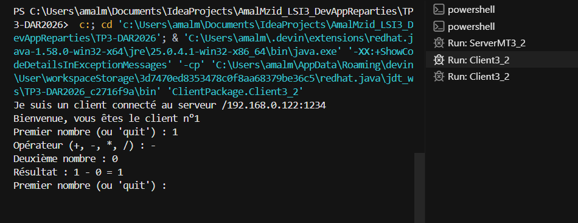

### Client n°2 depuis Windows

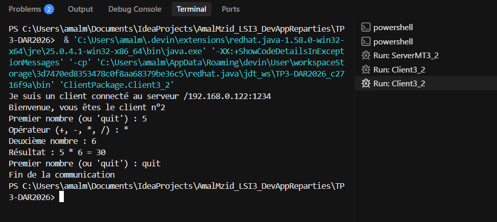

### Console du serveur sur la VM

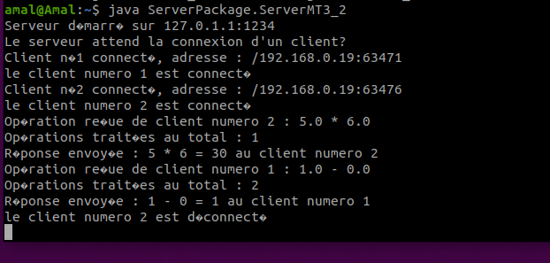

Les 2 clients Windows (`192.168.0.19`) envoient leurs objets `Operation` au serveur distant. Le
compteur global s'incrémente correctement (1 puis 2).
